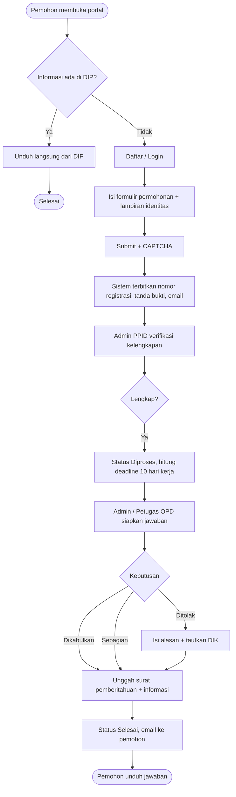
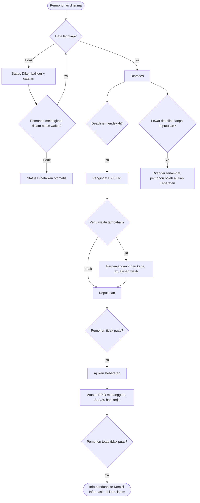
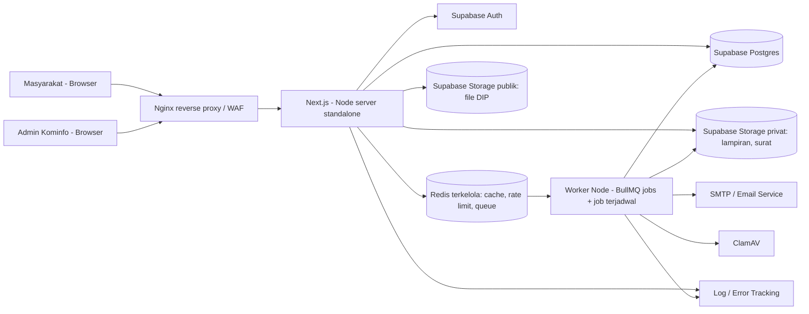
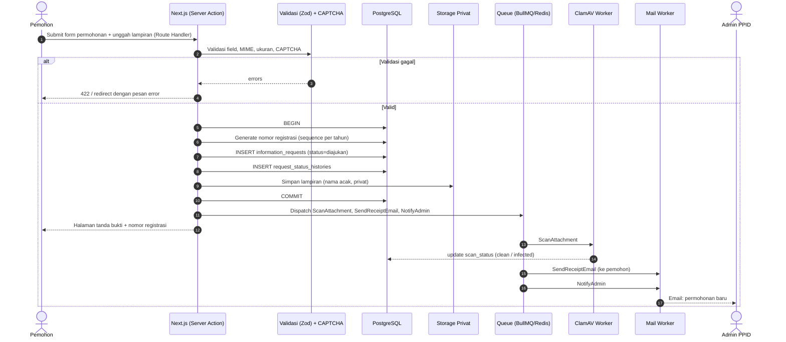
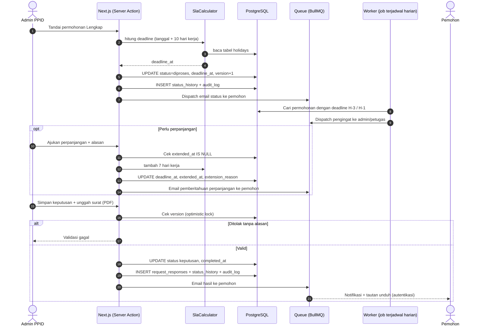
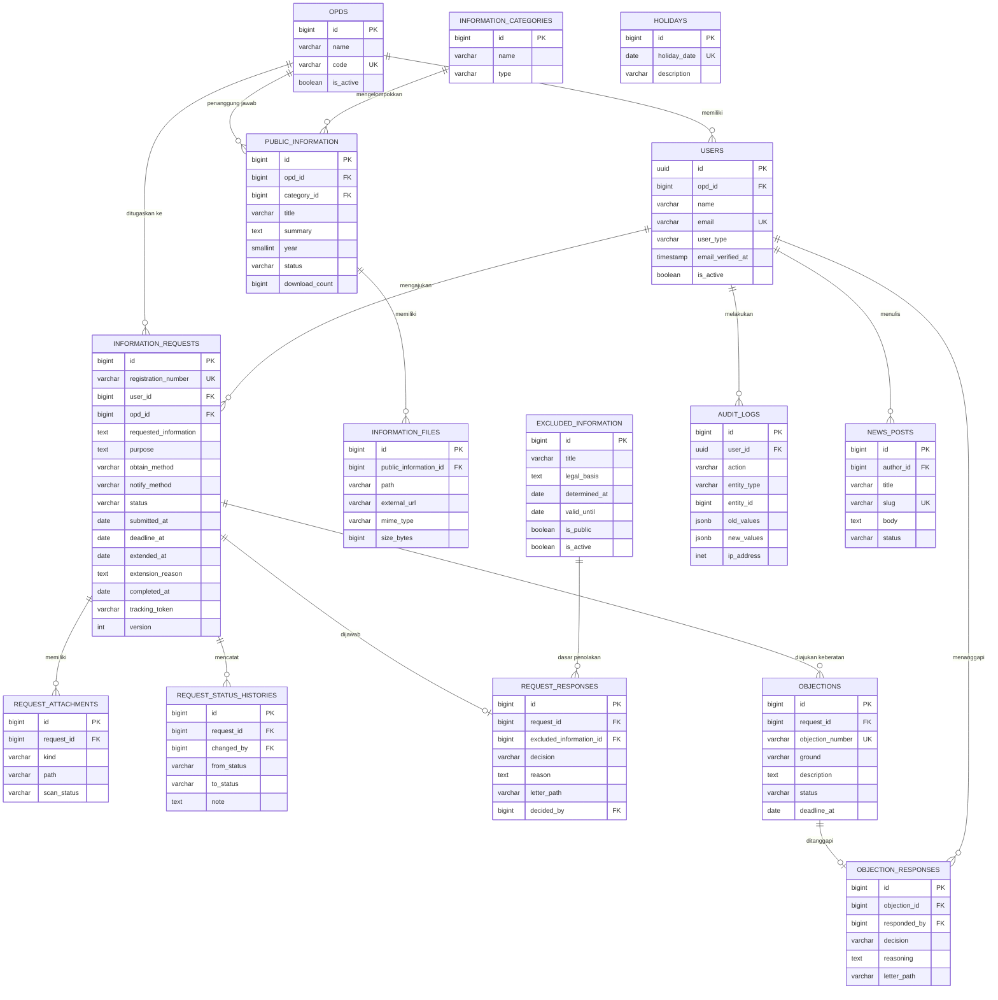

# PRD — PPID Kota Parepare

| Atribut | Nilai |
|---|---|
| Nama Produk | PPID Kota Parepare (Sistem Informasi Layanan Informasi Publik) |
| Versi Dokumen | 0.3 (Draft untuk review) — revisi: stack dibakukan (Next.js 16+, Tailwind 4+, shadcn/ui, Supabase, Prisma) |
| Platform | Web Desktop (responsive minimal, tidak menjadi prioritas) |
| Pengguna Utama | Administrasi Dinas Kominfo, Masyarakat Umum |
| Stack Terkunci | Full-stack Next.js 16+ (App Router) + TypeScript 5 + Tailwind CSS 4 + shadcn/ui + Supabase (Postgres, Auth, Storage) + Prisma |
| Standar Aksesibilitas | WCAG 2.2 Level AA **[Asumsi: diinterpretasikan dari "WCAG AA"; konfirmasi di Bagian 10]** |
| Status | Draft — menunggu validasi regulasi & keputusan terbuka (Bagian 10) |

> **Konvensi dokumen.** Tanda **[Asumsi]** = keputusan desain yang belum dikonfirmasi pihak Pemkot Parepare/Diskominfo. Angka target pada KPI dan NFR adalah **target usulan**, bukan baseline terukur. Rujukan regulasi harus **diverifikasi ulang** oleh tim hukum/PPID sebelum menjadi acuan final (lihat 1.4).

---

## 1. Overview

### 1.1 Executive Summary

PPID Kota Parepare adalah aplikasi web untuk mengelola dan mempublikasikan layanan informasi publik Pemerintah Kota Parepare sesuai kerangka Keterbukaan Informasi Publik. Sistem menyediakan tiga kemampuan inti:

1. **Portal informasi publik** — Daftar Informasi Publik (DIP) yang dapat dicari dan diunduh masyarakat.
2. **Layanan permohonan informasi & keberatan online** — dengan nomor registrasi, pelacakan status, dan pengukuran SLA otomatis.
3. **Pelaporan** — rekap layanan informasi untuk laporan tahunan PPID, dihasilkan dari data transaksi, bukan input manual.

Administrator Dinas Kominfo adalah operator utama sistem.

### 1.2 Problem Statement & Goals

**Masalah.** Pelayanan informasi publik yang dikelola manual (surat, WhatsApp, formulir kertas) berisiko: status permohonan tidak transparan, tenggat waktu jawaban tidak terpantau, dokumen publik tersebar, dan laporan layanan sulit direkap. **[Asumsi]** kondisi eksisting Parepare perlu dikonfirmasi saat discovery; dokumen ini tidak mengklaim kondisi aktual.

**Goals.**

| # | Goal | KPI (target usulan) | Cara Ukur |
|---|---|---|---|
| G1 | Permohonan dijawab tepat waktu | ≥ 95% permohonan selesai dalam batas waktu regulasi | `completed_at <= deadline_at` / total selesai |
| G2 | Transparansi status | 100% permohonan punya nomor registrasi & riwayat status yang dapat dilacak | Audit data |
| G3 | Ketersediaan informasi publik | 100% dokumen DIP berstatus *terbit* memiliki file/tautan valid | Job validasi tautan mingguan |
| G4 | Efisiensi pelaporan | Laporan tahunan dapat dihasilkan < 5 menit tanpa rekap manual | Uji penerimaan |
| G5 | Kepuasan pengguna | Skor survei ≥ 4,0/5 (fitur Could) | Survei pasca-layanan |
| G6 | Keandalan | Uptime ≥ 99,5%/bulan | Monitoring |

### 1.3 Scope & Out-of-Scope

**In scope (MVP + rilis lanjutan):**
- Portal publik (beranda, profil PPID, regulasi, SOP, maklumat, DIP, berita/pengumuman, FAQ)
- Permohonan informasi online, pelacakan status, notifikasi email
- Pengajuan keberatan online
- Back-office: kelola DIP, DIK, permohonan, keberatan, konten, pengguna
- Pengelolaan hari kerja/libur untuk perhitungan SLA
- Laporan & statistik layanan, ekspor PDF/XLSX
- Audit log
- Aksesibilitas WCAG 2.2 Level AA pada seluruh antarmuka (lihat 2.4)

**Out of scope:**
- Proses sengketa di Komisi Informasi (hanya halaman informasi/panduan, tidak ada integrasi)
- Aplikasi mobile native
- Pembayaran/biaya salinan online (biaya ditangani di luar sistem; sistem hanya mencatat nominal) **[Asumsi]**
- Integrasi dengan sistem arsip/e-Office OPD lain pada MVP
- Tanda tangan elektronik tersertifikasi pada MVP (surat balasan diunggah sebagai PDF)
- Jaminan aksesibilitas isi dokumen PDF yang diunggah OPD (sistem hanya mewajibkan deskripsi & menyediakan panduan; lihat AR-10)

### 1.4 Dasar Regulasi (untuk diverifikasi tim hukum)

| Regulasi | Relevansi pada produk |
|---|---|
| UU No. 14 Tahun 2008 tentang Keterbukaan Informasi Publik | Jenis informasi (berkala, serta-merta, setiap saat, dikecualikan), tenggat permohonan, keberatan, sengketa, kewajiban laporan layanan |
| PP No. 61 Tahun 2010 | Pelaksanaan UU KIP, tata cara permohonan |
| Peraturan Komisi Informasi No. 1 Tahun 2021 tentang Standar Layanan Informasi Publik | Standar layanan PPID, dasar pengaturan alur & kanal layanan |
| Permendagri No. 3 Tahun 2017 | Pengelolaan layanan informasi di lingkungan Pemda (struktur PPID Utama/Pembantu) |
| UU No. 27 Tahun 2022 tentang Pelindungan Data Pribadi | Pengelolaan data pemohon |

Parameter SLA yang dipakai sistem (dapat dikonfigurasi, bukan hard-code):
- Jawaban permohonan: **10 hari kerja**, dapat diperpanjang **7 hari kerja** dengan pemberitahuan tertulis beserta alasan.
- Tanggapan atasan PPID atas keberatan: **30 hari kerja**.

> Verifikasi pula: ada/tidaknya Peraturan Wali Kota Parepare tentang PPID yang mengatur struktur, SOP, dan formulir. Jika ada, nilai di atas dan formulir mengikuti peraturan tersebut.

---

## 2. Requirements

### 2.1 Peran Pengguna

| Peran | Deskripsi | Prioritas |
|---|---|---|
| Pengunjung | Mengakses informasi publik tanpa login | Must |
| Pemohon | Mengajukan & melacak permohonan/keberatan | Must |
| Admin PPID (Diskominfo) | Operator utama: kelola seluruh modul | Must |
| Super Admin | Kelola pengguna, peran, konfigurasi sistem | Must |
| Atasan PPID | Memberi tanggapan keberatan, melihat laporan **[Asumsi]** | Should |
| Petugas PPID Pembantu (OPD) | Mengelola DIP & menjawab permohonan milik OPD-nya **[Asumsi]** | Should |

### 2.2 Functional Requirements (per Modul)

**M1 — Autentikasi & Manajemen Pengguna**
- FR-1.1: Pemohon dapat mendaftar dengan email + verifikasi email. **[Asumsi]** Pengajuan tanpa akun (guest) tidak didukung agar pelacakan & keamanan lebih mudah; ini keputusan terbuka (Bagian 10).
- FR-1.2: Login/logout, reset password via email.
- FR-1.3: Admin/Petugas login terpisah dari pemohon (guard berbeda).
- FR-1.4: RBAC berbasis peran & permission.
- FR-1.5: 2FA (TOTP) untuk peran internal (Should).
- FR-1.6: Super Admin dapat menonaktifkan akun tanpa menghapus riwayat.

**M2 — Portal Informasi Publik (DIP)**
- FR-2.1: Daftar informasi dengan kategori: Berkala, Serta-merta, Tersedia Setiap Saat.
- FR-2.2: Atribut per informasi: judul, ringkasan, OPD penanggung jawab, kategori, tahun, waktu & tempat pembuatan, bentuk (file/tautan), status terbit.
- FR-2.3: Pencarian teks + filter (kategori, OPD, tahun).
- FR-2.4: Unduh file; hitung jumlah unduhan.
- FR-2.5: Halaman detail dengan metadata.
- FR-2.6: Alur terbit: Draft → Terbit → Diarsipkan.

**M3 — Permohonan Informasi**
- FR-3.1: Formulir permohonan: identitas pemohon (nama, alamat, kontak), rincian informasi yang diminta, tujuan penggunaan, cara memperoleh (melihat/salinan/soft copy), cara pemberitahuan.
- FR-3.2: Unggah lampiran identitas (format & ukuran dibatasi).
- FR-3.3: Penerbitan **nomor registrasi** dan **tanda bukti permohonan** (PDF) otomatis.
- FR-3.4: Verifikasi kelengkapan oleh admin; jika tidak lengkap → status *Dikembalikan* dengan catatan.
- FR-3.5: Penghitungan `deadline_at` berdasarkan hari kerja (kalender libur terkelola).
- FR-3.6: Perpanjangan waktu 1× dengan alasan tertulis.
- FR-3.7: Keputusan: Dikabulkan seluruhnya / sebagian / Ditolak; penolakan wajib alasan & rujukan dasar pengecualian.
- FR-3.8: Unggah surat pemberitahuan tertulis + informasi yang diberikan.
- FR-3.9: Pelacakan status publik dengan nomor registrasi + token.
- FR-3.10: Notifikasi email pada setiap perubahan status & pengingat SLA internal (H-3 dan H-1 hari kerja).

**M4 — Keberatan**
- FR-4.1: Pemohon dapat mengajukan keberatan atas permohonan yang telah ditanggapi/lewat waktu, dengan memilih alasan keberatan.
- FR-4.2: Keberatan ditautkan ke permohonan asal; satu permohonan dapat punya lebih dari satu keberatan hanya jika ditolak sistem validasi bisnis (default: 1 aktif).
- FR-4.3: Atasan PPID menanggapi; SLA 30 hari kerja dengan pengingat.
- FR-4.4: Status: Diajukan → Diproses → Diputuskan (Dikabulkan/Ditolak sebagian/seluruhnya).
- FR-4.5: Halaman panduan langkah lanjutan ke Komisi Informasi (konten statis).

**M5 — Daftar Informasi Dikecualikan (DIK)**
- FR-5.1: CRUD DIK: judul, dasar pengecualian, jangka waktu, tanggal penetapan, dokumen uji konsekuensi (lampiran).
- FR-5.2: DIK yang berstatus aktif dapat ditampilkan publik (judul & dasar saja).
- FR-5.3: Penolakan permohonan dapat menautkan ke DIK.

**M6 — Manajemen Konten**
- FR-6.1: Halaman statis: profil, struktur organisasi PPID, tugas & fungsi, maklumat pelayanan, SOP, regulasi, FAQ.
- FR-6.2: Berita/pengumuman PPID.
- FR-6.3: Editor rich-text dengan sanitasi HTML; menghasilkan struktur aksesibel (hierarki heading valid, alt text wajib untuk gambar, teks tautan deskriptif).

**M7 — Laporan & Statistik**
- FR-7.1: Dashboard admin: jumlah permohonan per status, mendekati/melewati SLA, rata-rata waktu respons.
- FR-7.2: Rekap tahunan layanan informasi: jumlah permohonan, dikabulkan/ditolak, keberatan, waktu penyelesaian, per OPD.
- FR-7.3: Ekspor PDF & XLSX.
- FR-7.4: Statistik publik ringkas (agregat, tanpa data pribadi).

**M8 — Administrasi Sistem**
- FR-8.1: Master OPD, kategori informasi, kalender hari kerja/libur.
- FR-8.2: Pengaturan template notifikasi email, parameter SLA.
- FR-8.3: Audit log (siapa, apa, kapan, IP) tak dapat diubah dari UI.
- FR-8.4: Survei kepuasan pasca-layanan (Could).

### 2.3 Non-Functional Requirements (target usulan)

| Kategori | Requirement |
|---|---|
| **Performance** | Halaman publik p95 < 2 s (TTFB < 600 ms) pada 200 pengguna bersamaan; pencarian DIP p95 < 1,5 s pada ≤ 50.000 entri; unggah lampiran ≤ 10 MB sukses < 15 s pada koneksi 10 Mbps |
| **Security** | HTTPS (TLS ≥ 1.2) wajib; hash password ditangani Supabase Auth (bcrypt, tidak disimpan aplikasi); proteksi CSRF, XSS, SQLi (Prisma: query berparameter; `$queryRaw` hanya tagged template), rate limiting (login, form publik); CAPTCHA pada form publik; validasi MIME & ekstensi lampiran + pemindaian antivirus; file privat tidak dapat diakses via URL langsung; header keamanan (CSP, HSTS, X-Frame-Options); acuan uji OWASP Top 10 / ASVS Level 2 sebelum go-live; penetration test sebelum rilis produksi |
| **Privacy** | Data pribadi pemohon hanya diakses peran berwenang; masking pada laporan agregat; kebijakan retensi data disepakati (Bagian 10); sesuai UU PDP |
| **Scalability** | Monolit modular, scale-up vertikal dahulu, siap scale-out horizontal (cache & antrean di Redis, sesi di cookie, file di object storage) |
| **Availability** | Uptime ≥ 99,5%/bulan di luar maintenance terjadwal; RPO ≤ 24 jam, RTO ≤ 4 jam; backup DB harian + file mingguan, uji restore berkala |
| **Observability** | Log terpusat, error tracking, health-check endpoint, alert uptime |
| **Accessibility** | WCAG 2.2 Level AA (**Must**) — rincian pada 2.4 |
| **Maintainability** | TypeScript strict; cakupan test otomatis modul kritis (SLA, status workflow) ≥ 80% **[target usulan]**; ESLint + Prettier + `tsc --noEmit` di CI |
| **Compatibility** | Browser desktop modern 2 versi terakhir (Chrome, Firefox, Edge, Safari) |
| **Localization** | Bahasa Indonesia; zona waktu Asia/Makassar (WITA) |

### 2.4 Standar Aksesibilitas — WCAG 2.2 Level AA

**Interpretasi.** "WCAG AA" dibaca sebagai **WCAG 2.2 Level AA** (memenuhi seluruh kriteria Level A dan AA). WCAG 2.2 dipilih karena memuat kriteria tambahan yang relevan untuk form dan autentikasi. **[Asumsi]** Konfirmasi versi dan cakupan di Bagian 10.

**Cakupan.** Wajib: seluruh halaman publik dan alur pemohon (registrasi, login, form permohonan/keberatan, pelacakan). Back-office: ikut standar yang sama, namun dapat dijadwalkan setelah alur publik bila sumber daya terbatas **[Asumsi]**. Platform "Web Desktop" **tidak** membebaskan kriteria reflow/zoom (pengguna low-vision memakai zoom tinggi di desktop).

| ID | Requirement | Kriteria WCAG terkait |
|---|---|---|
| AR-1 | Struktur semantik: landmark (`header/nav/main/footer`), satu `h1` per halaman, hierarki heading berurutan, `lang="id"` | 1.3.1, 2.4.6, 3.1.1 |
| AR-2 | Seluruh fungsi dapat dioperasikan dengan keyboard; tidak ada jebakan fokus; fokus selalu terlihat dan tidak tertutup elemen sticky/dialog; ada *skip link*; urutan fokus logis | 2.1.1, 2.1.2, 2.4.1, 2.4.3, 2.4.7, 2.4.11 |
| AR-3 | Kontras teks ≥ 4,5:1 (teks besar ≥ 3:1); komponen UI & indikator fokus ≥ 3:1; informasi tidak disampaikan hanya lewat warna; reflow pada lebar 320 CSS px; zoom teks 200%; spasi teks dapat diubah tanpa kehilangan konten | 1.4.1, 1.4.3, 1.4.4, 1.4.10, 1.4.11, 1.4.12 |
| AR-4 | Form: label terprogram, petunjuk & format jelas, identifikasi + saran perbaikan kesalahan, atribut `autocomplete` pada data identitas, data yang sudah diisi tidak diminta ulang | 1.3.5, 3.3.1, 3.3.2, 3.3.3, 3.3.7 |
| AR-5 | Autentikasi aksesibel: tidak mengandalkan tes kognitif (mengingat/menyalin/memecahkan puzzle) tanpa alternatif; paste & password manager diizinkan; CAPTCHA tidak menjadi satu-satunya jalur | 3.3.8 |
| AR-6 | Ukuran target interaktif ≥ 24×24 CSS px; fungsi drag-and-drop (mis. unggah) punya alternatif klik/keyboard | 2.5.7, 2.5.8 |
| AR-7 | Konten non-teks punya alternatif teks; bagan statistik disertai tabel/ringkasan teks | 1.1.1 |
| AR-8 | Notifikasi sukses/gagal diumumkan ke teknologi bantu tanpa memindahkan fokus (`role="status"` / `aria-live`); tidak ada perubahan konteks tak terduga saat input/fokus | 4.1.3, 3.2.1, 3.2.2 |
| AR-9 | Sesi berbatas waktu: peringatan sebelum habis + opsi perpanjang; data form tidak hilang | 2.2.1 |
| AR-10 | Tabel data memakai `th`/`scope`/`caption`; pagination dan filter aksesibel. Dokumen: PDF buatan sistem (tanda bukti, laporan) harus dapat diakses (**spike teknis**, lihat Bagian 8); PDF unggahan OPD wajib memiliki deskripsi teks pada DIP | 1.3.1, 1.1.1 |
| AR-11 | Judul halaman unik & deskriptif; tujuan tautan jelas; ada lebih dari satu cara menemukan halaman (menu, pencarian, peta situs); bantuan/kontak di posisi konsisten | 2.4.2, 2.4.4, 2.4.5, 3.2.3, 3.2.6 |
| AR-12 | Halaman Pernyataan Aksesibilitas + kanal umpan balik (Should) | — |

**Proses penjaminan (Definition of Done UI):**
1. Linting `eslint-plugin-jsx-a11y` lulus pada setiap PR.
2. Uji otomatis axe-core via Playwright pada halaman kunci; pelanggaran *serious/critical* memblokir merge.
3. Audit manual sebelum rilis: keyboard-only, pembaca layar (mis. NVDA di Windows), zoom 200% & reflow 320 px.
4. Uji otomatis hanya menangkap sebagian pelanggaran; lulus axe **tidak** berarti patuh WCAG AA. Audit manual adalah syarat go-live.
5. Komponen dari pustaka (Radix/shadcn) mempercepat, namun tetap diuji dalam konteks halaman nyata.

---

## 3. Core Feature

Legenda MoSCoW: **M** = Must, **S** = Should, **C** = Could, **W** = Won't (rilis ini).

| ID | Fitur | MoSCoW |
|---|---|---|
| F1 | Portal & pencarian DIP | M |
| F2 | Permohonan informasi online + nomor registrasi | M |
| F3 | Pelacakan status permohonan | M |
| F4 | Workflow pemrosesan & keputusan oleh admin | M |
| F5 | Perhitungan SLA berbasis hari kerja + pengingat | M |
| F6 | Pengajuan & tanggapan keberatan | M |
| F7 | Manajemen DIK | M |
| F8 | Manajemen konten (profil, regulasi, SOP, berita, FAQ) | M |
| F9 | Autentikasi & RBAC | M |
| F20 | Aksesibilitas WCAG 2.2 AA (seluruh UI) | M |
| F10 | Laporan tahunan & dashboard | S |
| F11 | Audit log | S |
| F12 | Peran OPD (PPID Pembantu) & Atasan PPID | S |
| F13 | 2FA peran internal | S |
| F14 | Survei kepuasan | C |
| F15 | Notifikasi WhatsApp | C |
| F16 | REST API publik (data DIP terbuka) | C |
| F17 | Pembayaran biaya salinan online | W |
| F18 | Aplikasi mobile native | W |
| F19 | Integrasi tanda tangan elektronik tersertifikasi | W |

### 3.1 Acceptance Criteria (Given-When-Then)

**F1 — Portal & Pencarian DIP (M)**
- *Given* terdapat informasi berstatus Terbit dengan kategori "Berkala", *When* pengunjung mencari kata kunci yang ada di judul, *Then* informasi muncul pada hasil dan dapat difilter per OPD/tahun.
- *Given* informasi berstatus Draft atau Diarsipkan, *When* pengunjung mencari, *Then* informasi tidak muncul di hasil publik.
- *Given* file informasi tersedia, *When* pengunjung menekan Unduh, *Then* file terunduh dan penghitung unduhan bertambah 1.

**F2 — Permohonan Informasi (M)**
- *Given* pemohon sudah login dan form valid, *When* pemohon mengirim permohonan, *Then* sistem menyimpan data, menerbitkan nomor registrasi unik, menampilkan tanda bukti (PDF), dan mengirim email konfirmasi.
- *Given* field wajib kosong atau lampiran melebihi batas ukuran/format, *When* pemohon mengirim, *Then* sistem menolak dengan pesan validasi per field dan tidak membuat registrasi.
- *Given* CAPTCHA tidak valid, *When* form dikirim, *Then* pengajuan ditolak.

**F3 — Pelacakan Status (M)**
- *Given* nomor registrasi dan token valid, *When* pengunjung membuka halaman lacak, *Then* sistem menampilkan status terkini dan riwayat tanpa menampilkan data pribadi.
- *Given* kombinasi nomor/token salah 5 kali berturut-turut dari IP yang sama, *When* percobaan berikutnya, *Then* sistem menerapkan rate limit sementara.

**F4 — Workflow Pemrosesan (M)**
- *Given* permohonan berstatus Diajukan, *When* admin menandai Lengkap, *Then* status menjadi Diproses, `deadline_at` dihitung, dan pemohon diberi notifikasi.
- *Given* permohonan tidak lengkap, *When* admin memilih Dikembalikan dan mengisi catatan, *Then* pemohon menerima email berisi catatan dan dapat melengkapi data tanpa membuat nomor baru.
- *Given* keputusan Ditolak, *When* admin menyimpan tanpa alasan, *Then* sistem menolak penyimpanan.
- *Given* keputusan final disimpan, *When* surat pemberitahuan diunggah, *Then* status menjadi Selesai dan pemohon dinotifikasi.
- *Given* status sudah Selesai, *When* pengguna mencoba mengubah keputusan, *Then* sistem menolak (status terminal), kecuali via Super Admin dengan jejak audit.

**F5 — SLA (M)**
- *Given* permohonan lengkap diterima pada hari kerja, *When* sistem menghitung tenggat, *Then* `deadline_at` = tanggal + 10 hari kerja dengan mengecualikan Sabtu, Minggu, dan tanggal pada tabel libur.
- *Given* admin memperpanjang waktu dengan alasan, *When* disimpan, *Then* `deadline_at` bertambah 7 hari kerja, perpanjangan hanya bisa dilakukan sekali, dan email pemberitahuan terkirim.
- *Given* tenggat tinggal 3 atau 1 hari kerja dan permohonan belum selesai, *When* job harian berjalan, *Then* admin & petugas terkait menerima pengingat.
- *Given* tenggat terlewati, *When* job harian berjalan, *Then* permohonan ditandai Terlambat pada dashboard.

**F6 — Keberatan (M)**
- *Given* permohonan sudah memiliki keputusan atau melewati tenggat, *When* pemohon mengajukan keberatan dengan alasan terpilih, *Then* sistem membuat keberatan berstatus Diajukan, tertaut ke permohonan, dan `deadline_at` 30 hari kerja dihitung.
- *Given* permohonan masih dalam proses dan belum melewati tenggat, *When* pemohon mencoba mengajukan keberatan, *Then* sistem menolak dengan penjelasan.
- *Given* atasan PPID menyimpan tanggapan, *When* status Diputuskan, *Then* pemohon menerima email dan halaman panduan Komisi Informasi ditautkan pada notifikasi.

**F7 — DIK (M)**
- *Given* admin menambah DIK dengan dasar pengecualian, *When* disimpan, *Then* entri tercatat dengan tanggal penetapan dan tampil pada daftar publik sesuai pengaturan visibilitas.
- *Given* DIK sedang ditautkan pada permohonan, *When* admin menghapusnya, *Then* sistem menolak penghapusan (gunakan nonaktifkan).

**F8 — Konten (M)**
- *Given* admin menyimpan konten dengan tag skrip, *When* disimpan, *Then* HTML disanitasi dan tag berbahaya dihapus.

**F9 — Autentikasi & RBAC (M)**
- *Given* Petugas OPD A, *When* mencoba membuka permohonan yang ditugaskan ke OPD B, *Then* akses ditolak (403) dan upaya tercatat di audit log.
- *Given* 5 kali gagal login, *When* percobaan berikutnya, *Then* akun/IP dikenai throttle sementara.

**F10 — Laporan (S)**
- *Given* terdapat data permohonan tahun berjalan, *When* admin memilih tahun & mengekspor, *Then* sistem menghasilkan PDF/XLSX berisi agregat per status, per OPD, dan rata-rata waktu penyelesaian yang cocok dengan angka dashboard.

**F11 — Audit Log (S)**
- *Given* pengguna internal mengubah keputusan, status, atau data DIP, *When* perubahan disimpan, *Then* audit log mencatat pengguna, aksi, nilai lama/baru, waktu, dan IP.

**F20 — Aksesibilitas WCAG 2.2 AA (M)**
- *Given* pengguna hanya memakai keyboard, *When* menavigasi dari awal halaman, *Then* *skip link* muncul pertama, fokus terlihat dengan urutan logis, dan semua kontrol (menu, form, tabel, dialog, unggah file) dapat dioperasikan tanpa jebakan fokus.
- *Given* form permohonan dikirim dengan field tidak valid, *When* validasi gagal, *Then* ringkasan error menerima fokus, setiap field bermasalah memiliki pesan teks yang terhubung secara terprogram, dan error tidak hanya dibedakan lewat warna.
- *Given* pembaca layar aktif, *When* status berubah atau notifikasi sukses muncul, *Then* perubahan diumumkan tanpa memindahkan fokus.
- *Given* lebar viewport 320 CSS px atau zoom 200%, *When* pengguna membuka halaman publik, *Then* tidak ada konten atau fungsi yang hilang dan tidak ada scroll horizontal pada halaman (kecuali tabel di dalam kontainer scroll sendiri).
- *Given* CAPTCHA/anti-bot aktif, *When* pengguna keyboard atau pembaca layar mengirim form, *Then* pengguna dapat menyelesaikan tanpa tantangan kognitif yang tidak memiliki alternatif.
- *Given* sebuah PR mengubah UI, *When* pipeline CI berjalan, *Then* uji axe pada halaman kunci harus bebas pelanggaran *serious/critical* atau merge diblokir.

---

## 4. User Flow

### 4.1 Happy Path — Permohonan Informasi



### 4.2 Edge Cases Utama



### 4.3 Edge Case Teknis (deskripsi langkah)

1. **Unggahan gagal/ukuran berlebih** → form dipertahankan (old input), pesan error per field, tidak ada registrasi parsial.
2. **File terdeteksi malware** → file dikarantina, permohonan tetap dapat disimpan tanpa lampiran, admin diberi tanda, pemohon diminta unggah ulang.
3. **Email notifikasi gagal** → job di-retry (backoff); setelah gagal maksimum, job berstatus *failed* pada antrean dan ditandai di dashboard admin; status permohonan tidak berubah.
4. **Dua admin mengubah permohonan bersamaan** → optimistic locking via kolom `version`; penyimpanan kedua ditolak dengan pesan konflik.
5. **Pergantian tahun / libur nasional baru** → admin memperbarui tabel `holidays`; tenggat yang sudah dihitung **tidak dihitung ulang otomatis** kecuali admin memicu rekalkulasi eksplisit (tercatat di audit).

---

## 5. Architecture

### 5.1 High-Level Overview

Pendekatan: **monolit modular Next.js (App Router, TypeScript)** ditambah **satu proses worker Node.js** dalam satu repositori. Alasan: tim kecil, domain sempit, transaksi workflow + SLA harus konsisten. Worker dipisah karena server Next.js tidak dirancang sebagai tempat job terjadwal atau pemindaian file yang berjalan lama (server dapat restart atau berjalan multi-instance). Microservices tidak dibenarkan pada skala ini.



| Layer | Komponen | Tanggung jawab |
|---|---|---|
| Frontend | Next.js 16+ App Router, React Server Components sebagai default, Client Components hanya untuk interaksi; Tailwind CSS 4 + shadcn/ui; komponen aksesibel | Render halaman publik (SEO, kinerja), UI back-office, pemenuhan WCAG 2.2 AA |
| Edge / "Gateway" | Nginx reverse proxy (+ WAF/CDN bila tersedia) | TLS termination, rate limit kasar, header keamanan. **Tidak ada API Gateway terpisah** karena tidak ada layanan terdistribusi |
| Backend (dalam Next.js) | **Server Actions** untuk mutasi form; **Route Handlers** untuk unggah/unduh file, health check, dan (Could) API publik | Titik masuk request; hanya memvalidasi input dan memanggil service |
| Service layer | `src/server/*`: `auth`, `public-info`, `requests`, `objections`, `exclusions`, `content`, `reports`, `admin`; helper `SlaCalculator`, `RegistrationNumberGenerator`, `ReportBuilder`, `NotificationService` | Business logic, workflow status, **otorisasi** (policy function berbasis `user_type` + `opd_id`), akses data |
| Worker | Proses Node terpisah (BullMQ) | Email, pemindaian antivirus, ekspor laporan, job terjadwal SLA |
| Data | Supabase Postgres (pooler Supavisor), Redis terkelola, Supabase Storage | Persistensi, cache, antrean, berkas |
| Integrasi | Supabase Auth, SMTP, anti-bot, ClamAV; (Could) gateway WhatsApp | Lihat Bagian 8 |

**Aturan arsitektur (wajib):**
1. **Otorisasi dilakukan di service/data layer pada setiap operasi**, bukan hanya di middleware atau layout. Next.js pernah memiliki kerentanan yang memungkinkan middleware dilewati (CVE-2025-29927), sehingga middleware hanya boleh menjadi lapisan tambahan.
2. Setiap Server Action diperlakukan sebagai endpoint publik: validasi input (Zod) + cek autentikasi + cek otorisasi di dalamnya.
3. Unggahan lampiran melalui **Route Handler** (bukan Server Action) agar batas ukuran body dan streaming ke storage dapat dikontrol; file disimpan di storage privat dengan nama acak dan hanya diunduh lewat Route Handler yang mengecek otorisasi.
4. Kode yang menyentuh DB/rahasia hanya di `src/server/*` (ditandai `server-only`), tidak diimpor dari Client Components.
5. **Tabel domain hanya diakses lewat Prisma di server.** `supabase-js` dipakai untuk Auth dan Storage saja; PostgREST tidak dipakai untuk tabel domain, sehingga otorisasi tidak bergantung pada RLS (lihat 8.1).

### 5.2 Strategi Caching
- **Halaman publik:** render statis/ISR dengan revalidasi per tag/path; Server Action admin memanggil revalidate saat konten, DIP, atau berita berubah. Perilaku cache default Next.js berbeda antar versi, sehingga **strategi cache ditetapkan eksplisit per route**, bukan mengandalkan default.
- **Redis terkelola:** cache data referensi (OPD, kategori), agregat statistik publik (TTL 5–15 menit), counter rate-limit lintas instance.
- **Aset:** file ber-hash dengan `Cache-Control` panjang.
- **Tidak di-cache:** halaman terautentikasi, status permohonan, data pribadi (dynamic rendering, `no-store`).
- **Query:** index pada kolom filter (status, deadline, OPD, tahun); hindari N+1 dengan query terstruktur/join.

### 5.3 Queue / Messaging
- **BullMQ di atas Redis** (tanpa message broker terpisah).
- Antrean: `mail`, `scan`, `reports`, `default`; retry dengan exponential backoff; job gagal terlihat pada dashboard admin (Bull Board opsional).
- **Job terjadwal** (repeatable jobs di worker, bukan cron dalam proses Next.js): pengingat SLA H-3/H-1, penandaan Terlambat, pembatalan otomatis permohonan *Dikembalikan* yang tidak dilengkapi, validasi tautan DIP mingguan, pembersihan token kedaluwarsa.

### 5.4 Deployment & Infrastruktur
- **Topologi:** Supabase sebagai layanan terkelola (Postgres, Auth, Storage) + host Node untuk dua proses: `web` (Next.js `output: 'standalone'`) dan `worker` (BullMQ + ClamAV). Docker Compose untuk lokal/self-host; produksi minimal satu container host untuk worker. Web boleh self-host Docker atau platform serverless **selama** worker tetap long-running.
- **Migrasi DB:** `prisma migrate deploy` sebagai langkah terpisah sebelum rilis, memakai `DIRECT_URL` (direct atau session pooler `:5432`) — **bukan** transaction pooler `:6543`. DDL di luar Prisma ditulis tangan di folder `prisma/migrations` (lihat 7.3).
- **Redis:** instance terkelola (mis. Upstash, region terdekat) atau container Redis pada host yang sama.
- **Lingkungan:** `local` → `staging` → `production`; staging memakai data sintetis.
- **CI/CD:** lint (ESLint) → typecheck (`tsc`) → unit/integration (Vitest) → E2E + a11y (Playwright + axe) → build → image → deploy staging otomatis → produksi dengan persetujuan manual. Migrasi DB dijalankan sebagai langkah terpisah sebelum rilis aplikasi.
- **Backup:** backup Postgres harian dari Supabase (paket wajib menyediakan backup + PITR untuk RPO ≤ 24 jam) **plus** salinan objek Storage mingguan ke lokasi terpisah — backup Supabase tidak menyertakan objek Storage. Uji restore berkala.
- **Monitoring:** uptime check eksternal, log terstruktur, error tracking, alert disk & antrean.

---

## 6. Sequence Diagram

### 6.1 Skenario Kritis 1 — Pengajuan Permohonan Informasi



### 6.2 Skenario Kritis 2 — Pemrosesan, Perpanjangan SLA, dan Keputusan



---

## 7. Database Schema

**Pilihan:** relasional (PostgreSQL). Alasan: integritas relasi (permohonan–keberatan–riwayat), transaksi untuk workflow, kebutuhan pelaporan agregat. Otorisasi diimplementasikan di service layer (policy function berbasis `users.user_type` dan `users.opd_id`), sehingga tidak ada tabel RBAC terpisah pada MVP. **Kredensial & sesi dikelola Supabase Auth** (skema `auth`, di luar Prisma); tabel `users` di `public` hanya menyimpan profil dan memakai `id` yang sama dengan `auth.users.id`.

### 7.1 ERD



*Tabel pendukung tanpa relasi kompleks (tidak digambar):* `static_pages`, `faqs`, `site_settings`, `notification_templates`, `satisfaction_surveys` (Could), serta tabel autentikasi/sesi milik Supabase Auth (skema `auth`, di luar Prisma). Antrean berada di Redis (BullMQ), bukan di database.

### 7.2 Nilai Enum (disimpan sebagai `varchar` + CHECK)

| Kolom | Nilai |
|---|---|
| `users.user_type` | `pemohon`, `admin_ppid`, `petugas_opd`, `atasan_ppid`, `super_admin` |
| `information_categories.type` | `berkala`, `serta_merta`, `setiap_saat` |
| `public_information.status` | `draft`, `terbit`, `diarsipkan` |
| `information_requests.status` | `diajukan`, `dikembalikan`, `diproses`, `dikabulkan`, `dikabulkan_sebagian`, `ditolak`, `selesai`, `dibatalkan` |
| `request_responses.decision` | `dikabulkan`, `dikabulkan_sebagian`, `ditolak` |
| `objections.status` | `diajukan`, `diproses`, `diputuskan` |
| `objections.ground` | disesuaikan dengan daftar alasan keberatan pada UU KIP (dikonfirmasi tim hukum) |

### 7.3 DDL Inti (PostgreSQL)

```sql
CREATE TABLE opds (
    id          BIGSERIAL PRIMARY KEY,
    name        VARCHAR(255) NOT NULL,
    code        VARCHAR(50)  NOT NULL UNIQUE,
    is_active   BOOLEAN      NOT NULL DEFAULT TRUE,
    created_at  TIMESTAMP, updated_at TIMESTAMP
);

-- Profil pengguna. Kredensial & sesi milik Supabase Auth (skema auth), bukan tabel ini.
CREATE TABLE users (
    id                UUID PRIMARY KEY,   -- = auth.users.id
    opd_id            BIGINT REFERENCES opds(id),
    name              VARCHAR(255) NOT NULL,
    email             VARCHAR(255) NOT NULL UNIQUE,
    user_type         VARCHAR(30)  NOT NULL
        CHECK (user_type IN ('pemohon','admin_ppid','petugas_opd','atasan_ppid','super_admin')),
    email_verified_at TIMESTAMP,
    is_active         BOOLEAN NOT NULL DEFAULT TRUE,
    created_at        TIMESTAMP, updated_at TIMESTAMP
);
-- Ditulis manual (di luar Prisma): FK lintas skema ke auth.users
ALTER TABLE users
    ADD CONSTRAINT fk_users_auth FOREIGN KEY (id) REFERENCES auth.users(id) ON DELETE CASCADE;

CREATE TABLE information_categories (
    id    BIGSERIAL PRIMARY KEY,
    name  VARCHAR(150) NOT NULL,
    type  VARCHAR(20)  NOT NULL CHECK (type IN ('berkala','serta_merta','setiap_saat'))
);

CREATE TABLE public_information (
    id             BIGSERIAL PRIMARY KEY,
    opd_id         BIGINT NOT NULL REFERENCES opds(id),
    category_id    BIGINT NOT NULL REFERENCES information_categories(id),
    title          VARCHAR(500) NOT NULL,
    summary        TEXT,
    year           SMALLINT,
    status         VARCHAR(15) NOT NULL DEFAULT 'draft'
        CHECK (status IN ('draft','terbit','diarsipkan')),
    download_count BIGINT NOT NULL DEFAULT 0,
    search_vector  TSVECTOR,
    created_at     TIMESTAMP, updated_at TIMESTAMP
);
CREATE INDEX idx_pubinfo_filter ON public_information (status, category_id, opd_id, year);
CREATE INDEX idx_pubinfo_fts    ON public_information USING GIN (search_vector);

CREATE TABLE information_requests (
    id                    BIGSERIAL PRIMARY KEY,
    registration_number   VARCHAR(40) NOT NULL UNIQUE,
    user_id               UUID   NOT NULL REFERENCES users(id),
    opd_id                BIGINT REFERENCES opds(id),
    requested_information TEXT   NOT NULL,
    purpose               TEXT   NOT NULL,
    obtain_method         VARCHAR(20) NOT NULL,
    notify_method         VARCHAR(20) NOT NULL DEFAULT 'email',
    status                VARCHAR(25) NOT NULL DEFAULT 'diajukan'
        CHECK (status IN ('diajukan','dikembalikan','diproses','dikabulkan',
                          'dikabulkan_sebagian','ditolak','selesai','dibatalkan')),
    submitted_at          DATE   NOT NULL,
    deadline_at           DATE,
    extended_at           DATE,
    extension_reason      TEXT,
    completed_at          DATE,
    tracking_token        VARCHAR(64) NOT NULL,
    version               INT    NOT NULL DEFAULT 1,
    created_at            TIMESTAMP, updated_at TIMESTAMP,
    CONSTRAINT chk_extension CHECK (extended_at IS NULL OR extension_reason IS NOT NULL)
);
CREATE INDEX idx_req_status_deadline ON information_requests (status, deadline_at);
CREATE INDEX idx_req_user            ON information_requests (user_id);

CREATE TABLE request_status_histories (
    id          BIGSERIAL PRIMARY KEY,
    request_id  BIGINT NOT NULL REFERENCES information_requests(id),
    changed_by  UUID   REFERENCES users(id),
    from_status VARCHAR(25),
    to_status   VARCHAR(25) NOT NULL,
    note        TEXT,
    created_at  TIMESTAMP NOT NULL DEFAULT NOW()
);

CREATE TABLE excluded_information (
    id            BIGSERIAL PRIMARY KEY,
    title         VARCHAR(500) NOT NULL,
    legal_basis   TEXT NOT NULL,
    determined_at DATE NOT NULL,
    valid_until   DATE,
    is_public     BOOLEAN NOT NULL DEFAULT FALSE,
    is_active     BOOLEAN NOT NULL DEFAULT TRUE
);

CREATE TABLE request_responses (
    id                      BIGSERIAL PRIMARY KEY,
    request_id              BIGINT NOT NULL UNIQUE REFERENCES information_requests(id),
    excluded_information_id BIGINT REFERENCES excluded_information(id),
    decision                VARCHAR(25) NOT NULL
        CHECK (decision IN ('dikabulkan','dikabulkan_sebagian','ditolak')),
    reason                  TEXT,
    letter_path             VARCHAR(500) NOT NULL,
    decided_by              UUID   NOT NULL REFERENCES users(id),
    created_at              TIMESTAMP,
    CONSTRAINT chk_reject_reason CHECK (decision <> 'ditolak' OR reason IS NOT NULL)
);

CREATE TABLE objections (
    id               BIGSERIAL PRIMARY KEY,
    request_id       BIGINT NOT NULL REFERENCES information_requests(id),
    objection_number VARCHAR(40) NOT NULL UNIQUE,
    ground           VARCHAR(60) NOT NULL,
    description      TEXT NOT NULL,
    status           VARCHAR(15) NOT NULL DEFAULT 'diajukan'
        CHECK (status IN ('diajukan','diproses','diputuskan')),
    deadline_at      DATE,
    created_at       TIMESTAMP, updated_at TIMESTAMP
);
-- Satu keberatan aktif per permohonan
CREATE UNIQUE INDEX uq_objection_active
    ON objections (request_id) WHERE status <> 'diputuskan';

CREATE TABLE holidays (
    id           BIGSERIAL PRIMARY KEY,
    holiday_date DATE NOT NULL UNIQUE,
    description  VARCHAR(255)
);
```

Tabel `request_attachments`, `information_files`, `objection_responses`, `news_posts`, `audit_logs`, dan tabel konten mengikuti kolom pada ERD (7.1) dengan pola constraint yang sama.

> **Catatan ORM (Prisma).** Prisma tidak mengekspresikan `CHECK`, *partial unique index*, `tsvector` + GIN, maupun FK lintas skema `auth.users`. Aturannya:
> 1. Tabel, kolom, relasi, dan index biasa di `schema.prisma`; `prisma migrate dev` menghasilkan migrasinya.
> 2. `CHECK`, partial unique index, kolom/indeks `tsvector`, dan FK ke `auth.users` **ditulis tangan** pada file migrasi Prisma (folder `prisma/migrations/*/migration.sql`) agar tetap terversi dan diterapkan `prisma migrate deploy`.
> 3. Skema `auth` ditandai `@@ignore` / tidak dimasukkan ke `schema.prisma` supaya `db pull` tidak mencoba memilikinya.
> 4. `search_vector` diisi trigger atau `GENERATED ALWAYS AS ... STORED` di DDL manual (Prisma tidak mengelolanya).

---

## 8. Tech Stack

**Stack terkunci (ditetapkan produk):** TypeScript 5 · Next.js 16+ · Tailwind CSS 4 · shadcn/ui · Supabase (Postgres, Auth, Storage) · Prisma.

| Area | Rekomendasi | Alasan / Catatan |
|---|---|---|
| **Bahasa** | **TypeScript 5** dengan `strict: true`, `noUncheckedIndexedAccess: true` | Ditetapkan produk. Tipe menjadi kontrak antara form, service, dan DB |
| **Framework (full-stack)** | **Next.js 16+** (App Router, React Server Components default) + React 19 | Ditetapkan produk. Satu codebase UI + backend; Server Components baik untuk halaman publik |
| **Catatan Next.js 16** | `middleware.ts` **berganti nama menjadi `proxy.ts`** (fungsi `proxy`, runtime Node.js tetap, opsi `runtime` dihapus). Gunakan `cacheComponents`/model cache baru; `params`/`searchParams` bersifat Promise | Konvensi lama masih jalan tapi *deprecated* dan tidak boleh dipakai pada proyek baru |
| **Styling** | **Tailwind CSS 4** (konfigurasi via CSS `@theme`, bukan `tailwind.config.js`) | Ditetapkan produk. Kontras & fokus tetap diuji terhadap WCAG |
| **Komponen UI** | **shadcn/ui** (Radix UI primitives, kode di-vendor ke repo, bukan paket npm) | Ditetapkan produk. Perilaku keyboard & ARIA dialihkan ke Radix; **tidak otomatis lulus AA** — setiap komponen yang dipakai wajib diuji (2.4) |
| **Form & validasi** | React Hook Form + Zod `zodResolver` (skema yang sama di client dan server) | Validasi server adalah otoritas; pesan error mengikuti AR-4 |
| **Tabel admin** | TanStack Table di atas komponen shadcn/ui | Sorting/filter/pagination; wajib mengikuti AR-10 |
| **Backend** | Server Actions + Route Handlers + service layer TypeScript | Lihat 5.1 |
| **Autentikasi** | **Supabase Auth** (`@supabase/ssr`: cookie berbasis `createServerClient`) | Ditetapkan produk. Verifikasi email, reset password, sesi server terpenuhi; **2FA TOTP tersedia di Supabase Auth (MFA)** namun wajib diverifikasi pada spike; alur login harus lolos 3.3.8 |
| **Otorisasi** | Policy function di service layer (basis `users.user_type` + `users.opd_id`) | **RLS tidak dijadikan lapisan otorisasi utama**, karena tabel domain hanya diakses Prisma (bypass RLS). Bila `supabase-js` dipakai langsung atas tabel domain, RLS wajib aktif — keputusan: tidak (lihat 5.1 aturan 5) |
| **ORM / Migrasi** | **Prisma** + migrasi SQL mentah untuk fitur yang tidak dimodelkan Prisma | Ditetapkan produk. Lihat aturan di 7.3; koneksi: `DATABASE_URL` (Supavisor, `?pgbouncer=true`) untuk runtime, `DIRECT_URL` untuk CLI migrasi |
| **Schema Prisma** | `prisma/schema.prisma` (satu file atau folder `prisma/schema/`), output client ke `src/generated/prisma` | `prisma migrate deploy` dijalankan sebagai langkah rilis terpisah |
| **Database** | **Supabase Postgres** | Transaksi kuat, CHECK/partial index, JSONB untuk audit log, FTS bawaan (konfigurasi `simple`; stemming bahasa Indonesia tidak diasumsikan tersedia) |
| **Koneksi DB** | Supavisor: session pooler `:5432` untuk server long-running, transaction pooler `:6543` + `pgbouncer=true` bila web serverless | Menghindari kehabisan koneksi; pooler tidak mempertahankan state sesi (jangan pakai `LISTEN/NOTIFY` atau `SET` sesi) |
| **Storage file** | **Supabase Storage**: bucket privat (lampiran, surat, lampiran identitas) + bucket publik (file DIP) | Ditetapkan produk. Unduh selalu lewat Route Handler yang memeriksa otorisasi lalu menerbitkan signed URL berumur pendek; objek tidak pernah diekspos langsung dari bucket privat |
| **Cache / Rate limit / Queue** | Redis terkelola (mis. Upstash) | Tiga fungsi dari satu komponen; Supabase tidak menyediakan cache/queue |
| **Queue & job terjadwal** | BullMQ (worker Node terpisah) | Retry, backoff, repeatable jobs; tidak ada broker tambahan |
| **Search** | PostgreSQL FTS + `pg_trgm` (MVP); Meilisearch jika relevansi kurang | Mulai sederhana |
| **PDF** | **Spike**: render PDF dengan dukungan tagged/aksesibel (kandidat: `@react-pdf/renderer`, atau render HTML→PDF via Chromium/Playwright) | Hasil PDF harus diverifikasi aksesibilitasnya; bila tidak memadai, sediakan versi HTML halaman tanda bukti sebagai alternatif |
| **Excel** | ExcelJS | Ekspor laporan |
| **Email** | SMTP via Nodemailer (atau Supabase Auth SMTP untuk email auth) | Notifikasi transaksional; templat email juga harus terbaca (semantik, kontras). Kuota email bawaan Supabase **tidak** untuk produksi |
| **Anti-bot** | Mekanisme **tanpa tantangan kognitif** (mis. Turnstile mode non-interaktif, honeypot, rate limit). Verifikasi dengan uji pembaca layar | Terkait WCAG 3.3.8; hindari puzzle gambar tanpa alternatif |
| **Antivirus** | ClamAV (self-hosted) | Pemindaian lampiran di worker; objek Storage diunduh, dipindai, lalu dikarantina |
| **Testing** | Vitest (unit/integration), Playwright (E2E) | Alur SLA dan workflow wajib teruji |
| **Testing aksesibilitas** | `eslint-plugin-jsx-a11y`, `@axe-core/playwright`, Lighthouse CI (pelengkap), audit manual (keyboard + NVDA + zoom) | Otomatis hanya sebagian; manual wajib (2.4) |
| **Kualitas kode** | ESLint (flat config), Prettier, `tsc --noEmit` | Konsistensi & deteksi bug dini |
| **DevOps** | Docker/Compose, GitHub Actions atau GitLab CI, Nginx, Ubuntu LTS | Provider-agnostic |
| **Observability** | Sentry (atau setara self-hosted), logger terstruktur (mis. pino), uptime monitor | Deteksi insiden |
| **Cloud / Hosting** | Supabase (terkelola) + host Node for `web` & `worker`; Redis terkelola | Region Supabase dan kepatuhan lokasi data menjadi keputusan terbuka (Bagian 10) |

### 8.1 Konsekuensi stack: yang harus dijaga

1. **Prisma melewati RLS.** Koneksi pooler Prisma memakai role DB dengan hak penuh. Karena itu **semua** query tabel domain lewat service layer yang memanggil policy function; `supabase-js` tidak dipakai untuk tabel domain (`public.*`), hanya Auth/Storage.
2. **Skema `auth` milik Supabase.** Tabel `users` di `public` adalah profil, `id UUID` = `auth.users.id`. Pembuatan profil terjadi di trigger `handle_new_user` (DDL manual) atau di service setelah sign-up; keduanya harus idempoten.
3. **`CHECK`, partial unique index, `tsvector`, FK ke `auth.users` tidak dimodelkan Prisma** → tulis tangan di file migrasi (7.3). `prisma migrate dev` dilarang memakai `--create-only` kosong yang menghapus objek ini.
4. **Backup Supabase tidak mencakup objek Storage.** Backup objek (bucket) dijadwalkan terpisah; RPO Storage dinyatakan eksplisit.
5. **Supabase free tier auto-pause** dan kuota (koneksi, bandwidth, storage) tidak memenuhi NFR Availability → paket berbayar wajib untuk staging/produksi.
6. **shadcn/ui = kode yang kita miliki.** Pembaruan komponen tidak otomatis; konfigurasi Tailwind 4 (`@theme`) dan CSS variables jadi kontrak desain. Semua override warna harus lolos kontras AA.
7. **Migrasi dari 0.2:** Keputusan ini membatalkan kandidat Drizzle ORM dan library auth pihak ketiga (Better Auth/Auth.js) — Auth kini Supabase Auth. Komponen yang sebelumnya "spike" (auth, ORM) menjadi terkunci, sehingga **spike kedua tidak lagi memilih library, melainkan memverifikasi kelayakan stack ini** (lihat daftar spike di bawah).

### Spike teknis (sebelum Fase 1, hasil mengunci keputusan di atas)
1. **Supabase Auth:** verifikasi email + reset password + sesi server (`@supabase/ssr`) + **MFA TOTP** berjalan; alur login lolos 3.3.8 dengan pembaca layar.
2. **Prisma + migrasi tangan:** partial unique index, `CHECK`, `tsvector`/GIN, dan FK `users.id → auth.users(id)` selamat dari `prisma migrate dev`/`deploy` ulang dan dari `prisma db pull`.
3. **Storage:** unggah ke bucket privat, unduh via Route Handler dengan signed URL, pemindaian ClamAV dari worker, dan uji akses langsung tanpa otorisasi (harus 403).
4. **Worker + BullMQ (Redis terkelola):** job terjadwal SLA berjalan benar lintas restart; reconnect Redis terverifikasi.
5. **PDF:** tanda bukti/laporan hasil sistem dapat diakses pembaca layar.
6. **Backup/restore:** uji restore dump DB **dan** objek Storage ke lingkungan bersih; catat RPO/RTO aktual.

## 9. Rencana Rilis (urutan, tanpa estimasi tanggal)

| Fase | Isi | Exit Criteria |
|---|---|---|
| 0 — Discovery & Spike | Konfirmasi regulasi/Perwali, formulir & SOP eksisting, keputusan terbuka, spike teknis (Bagian 8) | Dokumen keputusan ditandatangani PM & Diskominfo; hasil spike terdokumentasi |
| 1 — MVP | F1, F2, F3, F4, F5, F7, F8, F9, F20 | UAT lulus pada Given-When-Then bagian 3.1 |
| 2 — Keberatan & Laporan | F6, F10, F11 | Laporan tahunan cocok dengan data uji |
| 3 — Penguatan | F12, F13, keamanan (pentest), performa, audit aksesibilitas manual | Pentest tanpa temuan kritis/tinggi terbuka; audit WCAG AA tanpa temuan blocker terbuka |
| 4 — Opsional | F14, F15, F16 | Berdasarkan evaluasi penggunaan |

---

## 10. Keputusan Terbuka & Risiko

### Keputusan yang harus dikonfirmasi

| # | Pertanyaan | Dampak jika tidak dijawab | Rekomendasi default |
|---|---|---|---|
| 1 | Apakah ada Perwali/SK PPID Parepare, dan bagaimana struktur PPID Utama/Pembantu? | Peran, formulir, SLA bisa tidak sesuai | Ikuti Perwali bila ada |
| 2 | Apakah OPD (PPID Pembantu) memakai sistem langsung, atau hanya Kominfo yang menginput? | Menentukan F12 Must/Should | Kominfo input pada MVP |
| 3 | Permohonan tanpa akun (guest) diizinkan? | Desain auth & pelacakan | Wajib akun terverifikasi email |
| 4 | Hosting: pusat data Pemkot vs. cloud? | Biaya, kepatuhan, desain backup | Tentukan sebelum fase 1 |
| 5 | Kebijakan retensi data pemohon & lampiran | Kepatuhan UU PDP | Ditetapkan tertulis sebelum go-live |
| 6 | Perlu SSO/integrasi dengan sistem Pemkot lain? | Ruang lingkup auth | Tidak pada MVP |
| 7 | Formulir resmi permohonan/keberatan: field wajib persisnya? | Struktur form | Samakan dengan formulir eksisting |
| 8 | Biaya salinan: ada? dicatat di sistem? | Skema DB tambahan | Dicatat manual (nominal saja) |
| 9 | "WCAG AA" = WCAG 2.2 AA atau 2.1 AA? Berlaku untuk back-office juga? | Cakupan & biaya pengujian | 2.2 AA; publik Must, back-office mengikuti |
| 10 | Hosting Next.js: self-host Node (Docker) di infrastruktur Pemkot/cloud, atau platform serverless? | Worker, ClamAV, dan storage privat butuh server long-running | Self-host Docker untuk `web` + `worker`; Supabase terkelola |
| 11 | Siapa yang mengaudit aksesibilitas (internal/pihak independen)? | Syarat go-live | Audit manual internal + review independen bila anggaran ada |
| 12 | Region Supabase & kepatuhan lokasi data (UU PDP): apakah data pemohon boleh berada di region luar Indonesia? | Jika tidak boleh, Supabase terkelola cloud asing tidak memenuhi → perlu Postgres self-host (Supabase self-host/AWS RDS) dan stack berubah | Konfirmasi Diskominfo sebelum Fase 1; default asumsi: region terdekat (Singapore) **belum disetujui** |
| 13 | Paket Supabase (Free/Pro/Team) untuk staging & produksi | Free tier auto-pause, kuota koneksi/bandwidth, dan tanpa PITR → melanggar NFR Availability | Minimal Pro untuk staging & produksi |
| 14 | Postur RLS: tabel domain diakses Prisma (RLS bypass) — diterima sebagai risiko, atau RLS tetap diaktifkan sebagai pertahanan berlapis? | Lapisan pertahanan kedua hilang bila RLS tidak dipakai | Aktifkan RLS `deny-by-default` pada tabel domain sebagai lapisan kedua, meski akses utama lewat Prisma |

### Risiko

| Risiko | Mitigasi |
|---|---|
| Parameter SLA/regulasi berubah | SLA disimpan sebagai konfigurasi, bukan hard-code |
| Libur nasional/cuti bersama tidak terbarui → tenggat salah | Admin memelihara tabel `holidays`; pengingat tahunan; rekalkulasi eksplisit |
| Kebocoran data pribadi pemohon | RBAC ketat, enkripsi transport, penyimpanan privat, audit log, pentest |
| Adopsi rendah oleh OPD | Pelatihan, SOP, dashboard keterlambatan sebagai pemicu tindak lanjut |
| Ketergantungan pada satu operator (Kominfo) | Dokumentasi, minimal 2 admin terlatih, runbook operasional |
| Kerentanan framework Next.js / dependensi npm | Otorisasi di service layer (`proxy.ts` hanya lapisan tambahan), pembaruan rutin, `npm audit`/dependabot di CI, versi dikunci (lockfile) |
| **Prisma melewati RLS** → satu bug policy di service layer = kebocoran data lintas OPD | Semua akses tabel domain lewat service layer ber-policy; uji otorisasi otomatis per peran; RLS `deny-by-default` sebagai lapisan kedua (keputusan 14); lintas cek query di code review |
| **Vendor lock-in Supabase** (Auth/Storage/Postgres terkelola) | Skema DB tetap Postgres murni; Auth diakses via `@supabase/ssr` di balik abstraksi tipis (`src/server/auth`); Storage di balik abstraksi `fileStore` sehingga bisa dipindah ke S3-compatible |
| **Objek Storage tidak ikut backup DB Supabase** → kehilangan lampiran/surat | Backup objek mingguan ke lokasi terpisah + uji restore; RPO Storage dinyatakan di dokumen operasional |
| Kuota/limit Supabase (koneksi, bandwidth, storage) atau auto-pause menghentikan layanan | Paket berbayar; monitoring kuota; batas ukuran unggahan (≤ 10 MB) dan kuota per permohonan |
| **Prisma & migrasi tangan bertabrakan** (CHECK/partial index/tsvector/FK auth terhapus saat `migrate dev`) | Migrasi ditinjau di PR; CI menjalankan `prisma migrate deploy` ke DB kosong lalu membandingkan skema; larangan `migrate reset` di staging/produksi |
| Regresi aksesibilitas saat fitur bertambah | Gate axe di CI + audit manual berkala + komponen aksesibel terpusat |
| Dokumen PDF OPD tidak aksesibel | Field deskripsi wajib, panduan pembuatan PDF aksesibel, pemeriksaan PDF otomatis (Could) |

---

## Riwayat Revisi

| Versi | Perubahan |
|---|---|
| 0.1 | Draft awal (Laravel + Tailwind) |
| 0.2 | Stack diganti full-stack Next.js; ditambah standar WCAG 2.2 AA (2.4, F20, AR-1…AR-12); arsitektur, sequence diagram, tech stack, rencana rilis, dan keputusan terbuka disesuaikan |
| 0.3 | Stack dibakukan: TypeScript 5, Next.js 16+, Tailwind CSS 4, shadcn/ui, Supabase (Postgres/Auth/Storage), Prisma. `users.id` → UUID mengikuti `auth.users.id`; autentikasi & otorisasi, storage, koneksi pooler, backup, migrasi tangan Prisma, spike, risiko, dan keputusan terbuka (12–14) disesuaikan |
